<div align="center">

# A2UI Shop

**An Android shopping assistant whose answers aren't text. They're real, native UI.**

The agent replies with **A2UI** JSON, and the app turns it into Material 3 Jetpack Compose screens:
product cards, a checkout form with validation, and an order confirmation.


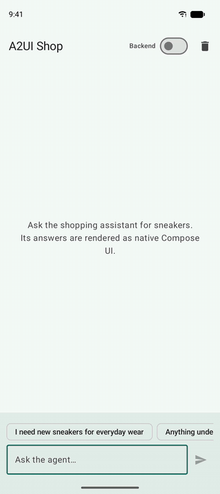

</div>

> [!NOTE]
> **This project was vibecoded for educational purposes.** It was built quickly with an AI coding assistant
> to explore and learn the alpha A2UI Compose renderer. It's a learning playground, not production code.
> The products and brands are fictional, and nobody is getting any sneakers.

---

## What is A2UI?

Most AI chat apps can only answer with text. If you ask a shopping assistant for sneakers, you get a
paragraph listing them, and then you still have to go find them yourself.

**A2UI (Agent-to-User Interface)** lets the agent answer with *UI* instead. The agent doesn't send code.
It sends a small JSON description, like "a horizontal list of product cards, bound to this data". The app
then draws it with **its own trusted native components**. So:

- **It's safe.** The agent can only use components the app already offers (its *catalog*). No code runs from the agent.
- **It looks native.** Everything is real Compose and Material 3. It follows the app's theme, accessibility settings and gestures.
- **It's live.** The agent can update just one value later (a price, a quantity) and the UI refreshes in place.

This app is a small, hands-on tour of those ideas using Google's
`androidx.compose.material3:material3-a2ui` library.

---

## How it works

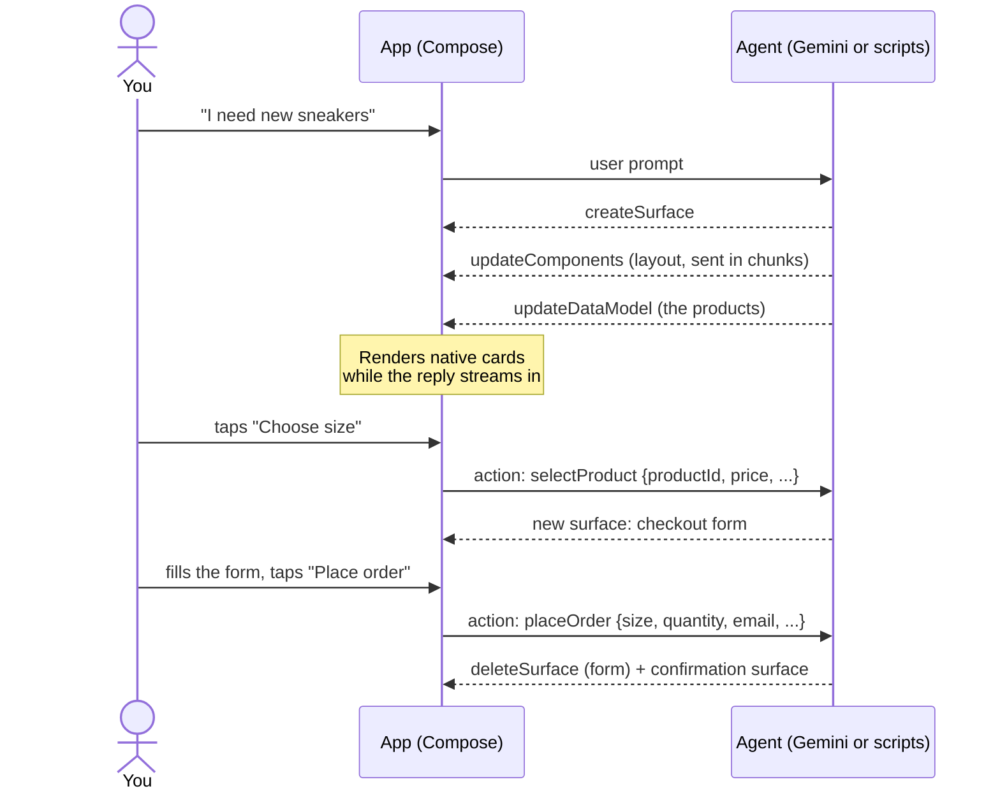

The agent describes UI with four kinds of messages:

| Message | What it does |
|---|---|
| `createSurface` | Opens a new area of UI (a *surface*) and says which component catalog it uses. |
| `updateComponents` | Adds or changes components in a surface, such as `Card`, `Text`, `List` or a custom `ProductCard`. |
| `updateDataModel` | Changes the data the components are bound to. The UI updates without being resent. |
| `deleteSurface` | Removes a surface, for example the checkout form once the order is placed. |

The app talks back with **actions** (the user tapped something) and **errors** (the agent sent something the
app can't render).

### Two kinds of agent

The app can talk to a real LLM or to a scripted stand-in. Use the **Backend** switch in the top bar to choose.

| | **Scripted** (default) | **AI mode** (Backend on + Gemini key) |
|---|---|---|
| Where it runs | Inside the app, no server needed | The FastAPI backend in [`backend/`](backend) |
| Who writes the UI | Scripted replies in [`assets/scripts`](app/src/main/assets/scripts), picked by keywords | **Gemini** writes the A2UI JSON live, streamed line by line |
| What you can ask | The demo prompts below (and similar wording) | Anything: *"something white for a wedding"*, *"I'm going camping next weekend"*, *"compare these two"* |
| Shop | 4 sneakers | 192 products in 17 categories (shoes, clothing, tech, kitchen, pets, …) |
| Best for | A predictable, offline walkthrough | Seeing a real model build native UI |

In AI mode, Gemini gets the app's **real catalog**: a JSON Schema the app exports with `catalog.toJsonSchemaString()`.
It also gets the product inventory and a few worked examples. It streams NDJSON, and the server forwards each
message as soon as it's complete, so the first UI appears in about 2 seconds while the model is still writing.
It remembers the conversation per chat, and tapping the trash icon (Clear chat) starts a new chat. If Gemini can't be reached, the server
falls back to the scripted replies.

---

## A walk through the demo

### 1. Ask for sneakers → progressive rendering and templates

<table>
<tr>
<td width="50%" align="center">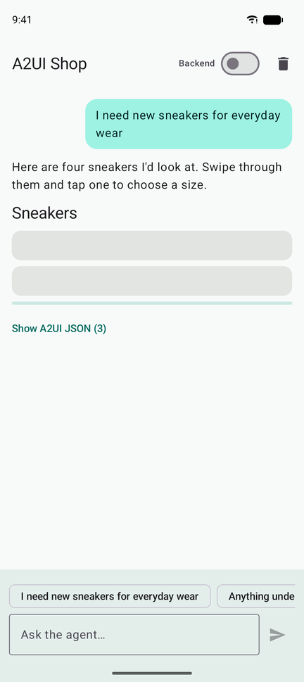<br/><sub>While streaming: the layout arrives first</sub></td>
<td width="50%" align="center">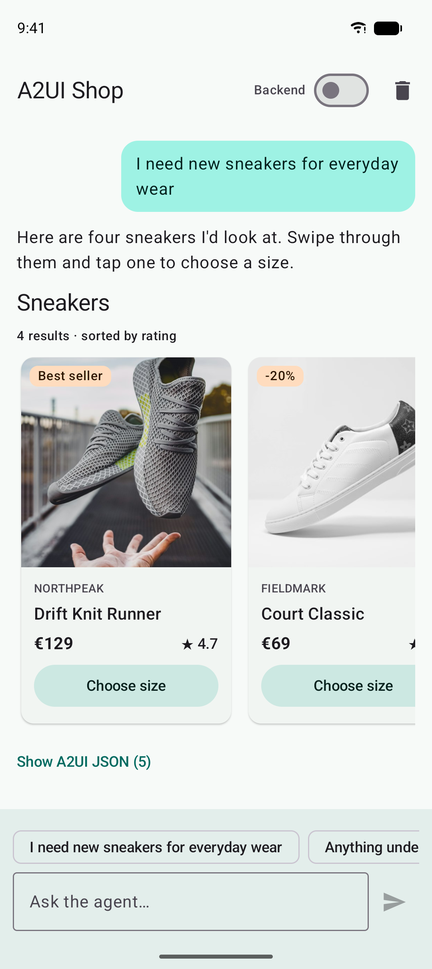<br/><sub>Done: native product cards</sub></td>
</tr>
</table>

The agent sends the UI **in chunks**: first the layout, then the title, then the list. The app draws each piece as
soon as it arrives, so you see the answer build up instead of waiting for all of it.

The four cards come from **one template**. The agent defines a single `ProductCard` and binds a `List` to the
`/products` array. The list stamps out one card per product:

```json
{
  "id": "results",
  "component": "List",
  "direction": "horizontal",
  "children": { "componentId": "product", "path": "/products" }
}
```

`ProductCard` isn't a built-in A2UI component. It's a **custom component** this app adds to its catalog, so the
agent can ask for it by name.

### 2. "Anything under €100?" → change the data, not the UI

<table>
<tr>
<td width="50%" align="center">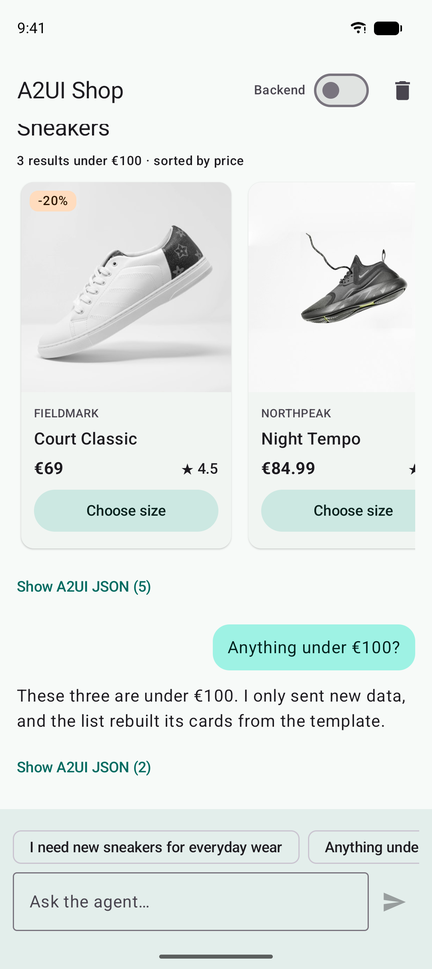</td>
<td width="50%">

The agent doesn't rebuild the screen. It sends **only new data**:

```json
{
  "updateDataModel": {
    "surfaceId": "sneaker-results",
    "path": "/products",
    "value": [ /* 3 cheaper sneakers */ ]
  }
}
```

The list sees that `/products` changed and rebuilds its cards from the same template.

</td>
</tr>
</table>

### 3. Tap "Choose size" → actions and a validated form

<table>
<tr>
<td width="50%" align="center">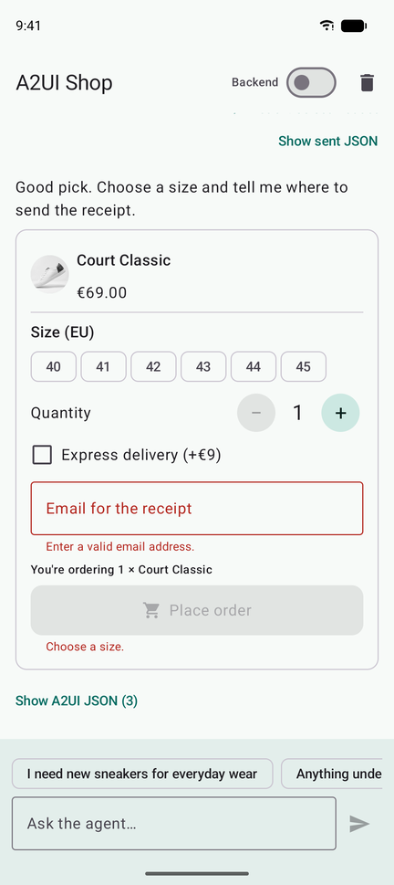</td>
<td width="50%">

Tapping the button sends an **action** to the agent (`selectProduct`, with the product's id, name and price).
The agent answers with a checkout form.

- Every input is **two-way bound** to the data model (`/order/size`, `/order/email`, …).
- **Checks** run on the device: `required` and `email` keep **Place order** disabled until the form is valid, and show the messages you see here.
- "You're ordering 1 × Court Classic" is built on the device with `formatString`, and the price uses `formatCurrency`.
- The quantity stepper is a **custom input component** made for this app.

</td>
</tr>
</table>

### 4. "Actually, I need two pairs" → one value, updated in place

<table>
<tr>
<td width="50%" align="center">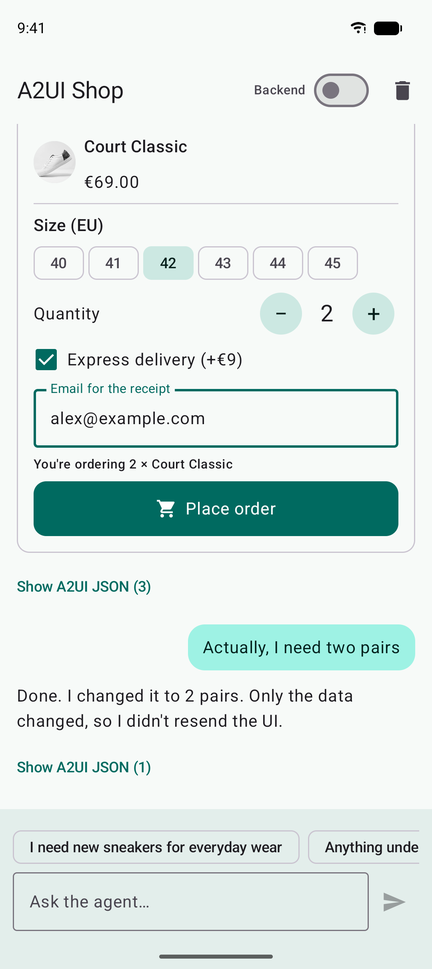</td>
<td width="50%">

The whole reply from the agent is this:

```json
{
  "updateDataModel": {
    "surfaceId": "checkout",
    "path": "/order/quantity",
    "value": 2
  }
}
```

The stepper and the summary line both read `/order/quantity`, so they both update. Fill in a size and an
email and **Place order** turns on.

</td>
</tr>
</table>

### 5. Place the order → remove the form, show a confirmation

<table>
<tr>
<td width="50%" align="center">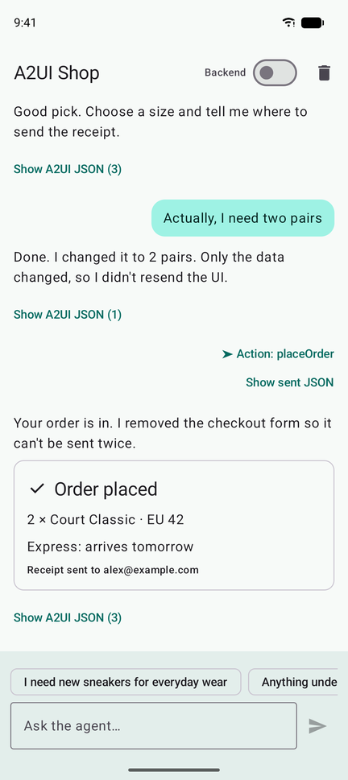</td>
<td width="50%">

The `placeOrder` action carries the form's values. The app reads them **at the moment you tap**, so the
agent gets exactly what's on screen.

The agent then sends `deleteSurface` for the checkout form, so it can't be submitted twice, and opens a new
confirmation surface.

</td>
</tr>
</table>

### 6. "What size should I get?" → the agent fixes its own mistake

<table>
<tr>
<td width="50%" align="center">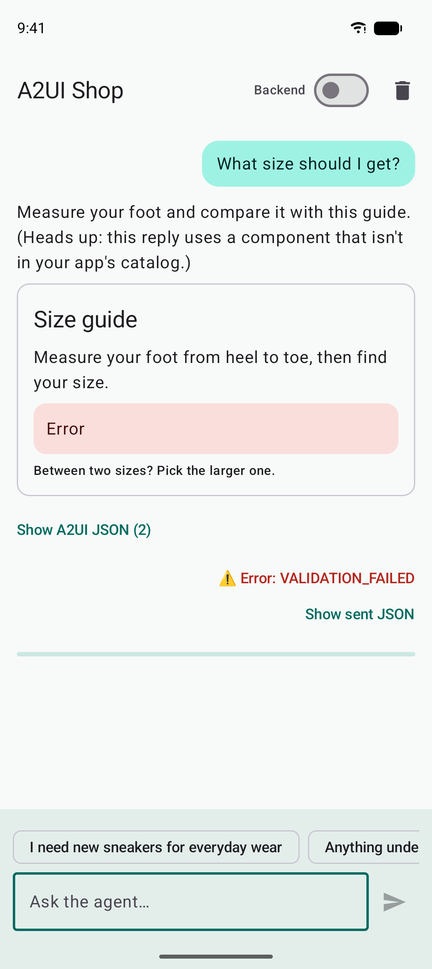<br/><sub>Before: the agent asked for a component that doesn't exist</sub></td>
<td width="50%" align="center">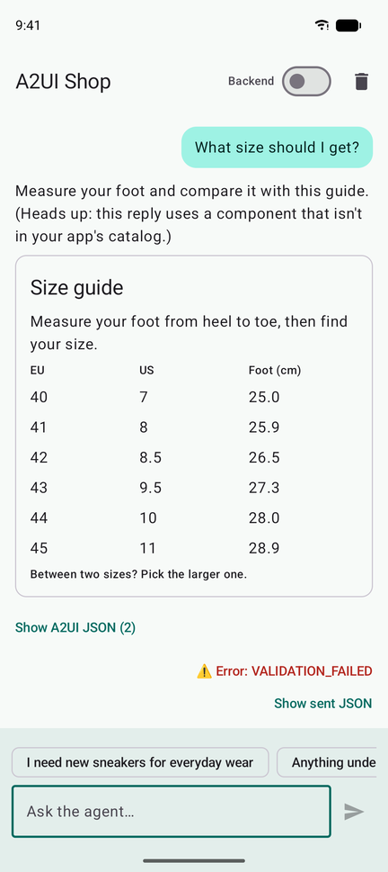<br/><sub>After: the agent rebuilt it with real components</sub></td>
</tr>
</table>

In the scripted demo, the agent asks for a `FootScanner3D` component on purpose. It isn't in the app's catalog.
Instead of crashing, the app:

1. **isolates** the broken piece (the rest of the card still renders),
2. sends a `VALIDATION_FAILED` error back to the agent,
3. and the agent **self-corrects** by resending that part as a table built from `Row`s and `Text`s.

The same loop protects AI mode. When Gemini writes UI the catalog rejects, the error goes back and the model fixes
its own UI on the next turn. The app stops after two automatic retries.

### See the raw JSON

<table>
<tr>
<td width="50%" align="center">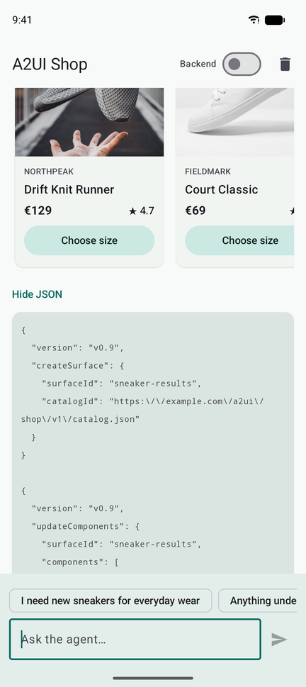</td>
<td width="50%">

Every agent reply has a **Show A2UI JSON** button, and every action or error has **Show sent JSON**. Open
them while you try the demo to see exactly which messages produced each screen. It's the quickest way to
learn the protocol.

</td>
</tr>
</table>

---

## Run it

**Requirements:** Android Studio, JDK 17+, and Android SDK Platform **37.1** (A2UI needs it to compile):

```bash
sdkmanager "platforms;android-37.1"
```

**Install on a device or emulator:**

```bash
./gradlew :app:installDebug
```

That's all you need for the scripted demo. The in-app agent works offline, but product photos load from
Unsplash, so they need internet.

**Optional: AI mode.** Run the FastAPI backend in [`backend/`](backend) with a
[Google AI Studio](https://aistudio.google.com/apikey) key:

```bash
cd backend
python3 -m venv .venv && .venv/bin/pip install -r requirements.txt
cp .env.example .env          # paste your GEMINI_API_KEY into .env
.venv/bin/uvicorn main:app --reload --host 0.0.0.0 --port 8000
```

Then forward the port to the emulator or phone, and turn on the **Backend** switch in the app:

```bash
adb reverse tcp:8000 tcp:8000
```

The server prints which mode it's in. Without a key (or with `AGENT_MODE=script`), it plays the same scripts as
the app. The app uses `localhost` through `adb reverse` because apps targeting SDK 37 can't reach `10.0.2.2`
without the `ACCESS_LOCAL_NETWORK` permission.

> [!TIP]
> **Product images blank on the emulator?** If the emulator was restored from an old snapshot, its clock may be
> behind, and HTTPS fails with `SSLHandshakeException: Chain validation failed`. Cold-boot the emulator
> (Device Manager → ⋮ → *Cold Boot Now*) so the clock syncs.

### Things to try

The suggestion chips are things a shopper might type. The scripted agent matches keywords, so your own wording
works too ("any cheaper ones?", "which size fits me?").

| You say or do | A2UI concept you'll see |
|---|---|
| "I need new sneakers for everyday wear" | `createSurface` + `updateComponents` in chunks (**progressive rendering**), and a `List` **template** |
| "Anything under €100?" | `updateDataModel` only. The list rebuilds from the template |
| Tap **Choose size** on a card | An **action** from a custom component. A form with **two-way binding** |
| "Actually, I need two pairs" | One data value changes. Every bound component updates |
| Fill the form, tap **Place order** | **Checks** (`required`, `email`), action context, `deleteSurface` |
| "What size should I get?" | Unknown component → `VALIDATION_FAILED` → agent **self-corrects** |

In **AI mode**, go off script: *"a gift for my dad who loves coffee"*, *"I'm going camping next weekend"*,
*"compare these two"*, *"my foot is 27 cm, what size?"*. Gemini picks the layout and the components itself.

---

## Project structure

```
app/src/main/java/com/example/a2uishop/
├── a2ui/
│   ├── ShopCatalog.kt               the catalog: Basic Catalog + one override + custom components
│   ├── ProductCardComponent.kt      a domain component: dynamic properties, an action, a template-bug workaround
│   ├── QuantityStepperComponent.kt  a new input component (A2uiProperty, bind/bindUpdater)
│   ├── CheckoutButtonComponent.kt   replaces the Basic Catalog Button, including checks
│   ├── MediaRenderers.kt            Coil for images (A2UI doesn't bundle a media library)
│   └── ClientMessageJson.kt         outbound actions/errors → A2UI JSON
├── agent/
│   ├── FakeAgent.kt                 in-app scripted agent that replays scripts from assets/
│   └── BackendAgent.kt              talks to the FastAPI backend (Gemini or scripts) over an NDJSON stream
└── ui/
    ├── ChatViewModel.kt             A2uiMessageProcessor, parser, outbound events
    ├── ChatScreen.kt                the chat UI; renders each surface with A2uiSurface
    └── components/                  plain Compose UI used by the custom components

app/src/main/assets/scripts/         the scripted agent's replies, one JSON file per scenario

backend/                             the FastAPI agent: Gemini (AI mode) or the same scripts
├── main.py                          the /agent endpoint, streams NDJSON, picks the mode
├── llm_agent.py                     Gemini client, streaming, and fix-ups for the model's output
├── prompt.md                        the system prompt: renderer rules, conventions, examples
├── data/                            the app's exported catalog schema + 192 products
└── scripts/                         a copy of the app's scripts, for script mode
```

> [!NOTE]
> **Why is the backend in this repo?** It started as a separate project. It was placed in this repository
> for faster development: one clone gives you both halves, and a change to the app's catalog and the matching
> change to the agent's prompt land in the same commit. See [backend/README.md](backend/README.md) for the API
> and how AI mode works.

**Where to start reading:** [ChatViewModel.kt](app/src/main/java/com/example/a2uishop/ui/ChatViewModel.kt) shows how
messages flow in and out. [ShopCatalog.kt](app/src/main/java/com/example/a2uishop/a2ui/ShopCatalog.kt) shows how the app
decides which components the agent may use.

---

## alpha02 quirks worked around here

The A2UI Compose library is still in alpha. These are the rough edges this project ran into:

- **Relative paths in actions inside templates.** A relative path (`{"path": "id"}`) in an action's context
  doesn't resolve inside a template, and one unresolved value empties the whole context. `ProductCard` adds
  its product to the context itself.
- **`formatCurrency` and whole numbers.** It rejects whole numbers sent as integers (`69`). The scripts send `69.0`,
  and in AI mode the server turns the model's whole-number prices into decimals before forwarding them.
- **Horizontal `List` stretching.** A horizontal `List` defaults to `"align": "stretch"`, which stretches items to
  the surface height. The scripts use `"align": "start"`.

---

<div align="center">
<sub>Vibecoded for educational purposes · Built to learn A2UI on Android · Product photos from <a href="https://unsplash.com">Unsplash</a></sub>
</div>
